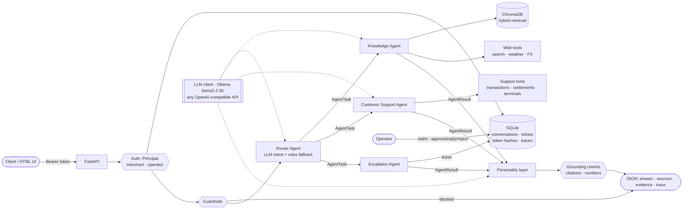
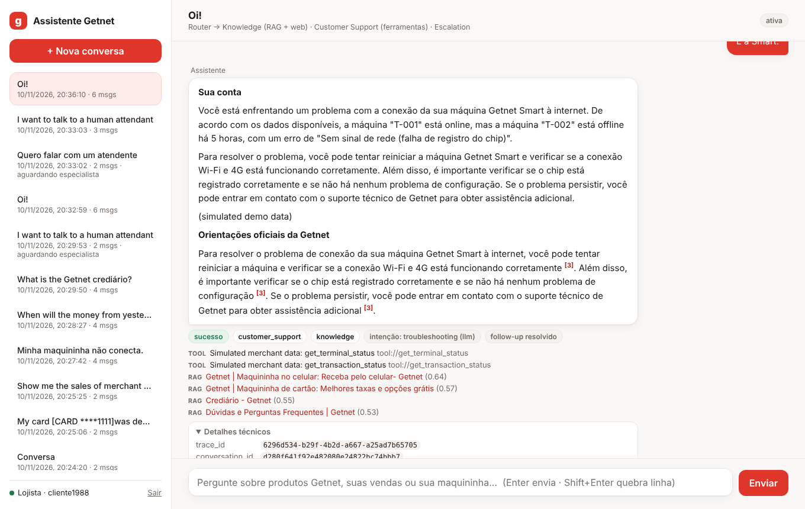
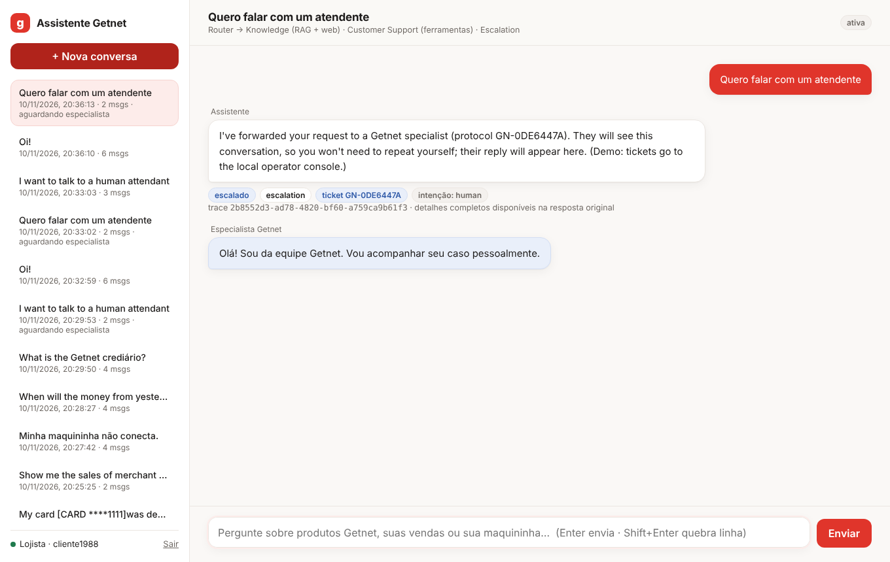

# Getnet AI Multi-Agent Support System

Multi-agent AI customer support system featuring intelligent routing, RAG-powered knowledge
retrieval and customer support tools. Built for the **Getnet AI Hardcore Engineer** technical
assessment.

> **It runs 100 % free and local.** The LLM is `llama3.2:3b` on Ollama, embeddings come from
> multilingual MiniLM (ONNX, CPU), the vector database is ChromaDB, state lives in SQLite (Python
> standard library) and web data comes from free public APIs. The LLM layer is OpenAI-compatible,
> so Groq (free tier) or OpenAI can be used by changing `.env`; `LLM_PROVIDER=anthropic` uses Claude.

> **Version 2 (remediation after evaluator feedback).** The original submission is preserved at the
> git tag `v1.0-submission`. Version 2 adds authentication, persistent multi-turn memory, an
> operational human-in-the-loop workflow, evidence-backed grounding checks, an evaluation harness,
> bounded replanning, observability and an HTML interface. Every change is mapped to the evaluators'
> six gaps in [`CHANGELOG.md`](CHANGELOG.md); measured before/after results are in
> [`docs/evaluation.md`](docs/evaluation.md).

---

## Contents
1. [Overview](#1-overview)
2. [Architecture](#2-architecture)
3. [Agents](#3-agents)
4. [Tech stack](#4-tech-stack)
5. [Spec-Driven Development](#5-spec-driven-development)
6. [Quick start (local)](#6-quick-start-local)
7. [Configuration](#7-configuration)
8. [Docker](#8-docker)
9. [Tests](#9-tests)
10. [API](#10-api)
11. [RAG pipeline](#11-rag-pipeline)
12. [Agent communication workflow](#12-agent-communication-workflow)
13. [LLM integration & prompt strategy](#13-llm-integration--prompt-strategy)
14. [Security, memory, human-in-the-loop & observability](#14-security-memory-human-in-the-loop--observability)
15. [Design decisions & trade-offs](#15-design-decisions--trade-offs)
16. [Known limitations](#16-known-limitations)
17. [Production readiness & evaluation strategy](#17-production-readiness--evaluation-strategy)
18. [Future enhancements](#18-future-enhancements)
19. [HTML interface](#19-html-interface)
20. [Semantic evaluation](#20-semantic-evaluation)

---

## 1. Overview

A merchant sends a message to `POST /chat`. The **Router Agent** classifies the intent and builds
a plan: one agent, or a sequence of agents. It then runs the specialists, passing each agent's
result to the next, and a **Personality** layer consolidates everything into one on-brand
answer. The response includes sources and a full execution trace.

| Capability | Implementation |
|---|---|
| Router (entry point, plans, data flow) | LLM JSON intent classification with a rules fallback; sequential plans with context propagation; **bounded deterministic replanning** |
| Knowledge Agent | **Hybrid RAG** over 46 official Getnet pages (`getnet.net/en` + `site.getnet.com.br`) **plus** web tools (search, weather, FX); **evidence retained + deterministic grounding checks** |
| Customer Support Agent | 3 tools over **simulated** merchant data: transactions, settlement schedule, terminal status; merchant identity from the **authenticated principal** |
| Escalation Agent (4th agent) | **Persistent human-in-the-loop**: ticket queue, atomic claim, approve AI draft / reply / reject, conversation resumes |
| Authentication | Bearer tokens (hashed in SQLite), merchant/operator roles; `user_id` can no longer select identity |
| Conversations | Persistent multi-turn memory (SQLite), owner-scoped, follow-up rewriting, survives restarts |
| Guardrails | Prompt-injection and unsafe-content blocking; card/CPF/CNPJ masking before the LLM sees or stores the text |
| Observability | JSON logs with `trace_id`; per-step agents, tools, latency, tokens, grounding and evidence in every response; persisted traces; operator-only `/metrics` |
| HTML interface | `/ui`: chat, conversation history, technical details, operator queue (vanilla JS, no build) |

## 2. Architecture



This follows the assessment's reference diagram (*Input → Router → Knowledge / Customer Support
/ Custom agent + Tools → Personality → Output*). Details: [`docs/architecture.md`](docs/architecture.md).

```
app/
├── main.py                 # FastAPI: /chat, /conversations, /operator/*, /metrics, /me, /health, /ui
├── container.py            # composition root (dependency injection)
├── config.py               # pydantic-settings (env-driven)
├── agents/
│   ├── router.py           # Router Agent + orchestration
│   ├── knowledge.py        # Knowledge Agent (RAG + web tools)
│   ├── customer_support.py # Customer Support Agent (tool planning + execution)
│   ├── escalation.py       # Escalation Agent (bonus)
│   ├── personality.py      # Personality / consolidation layer
│   ├── prompts.py          # all prompts, in one place
│   └── base.py             # BaseAgent (timing, error isolation, language detection)
├── rag/
│   ├── ingest.py           # crawl → extract → snapshot → chunk → index (CLI)
│   ├── chunker.py          # paragraph-aware chunking with overlap
│   ├── hybrid.py           # BM25 + Reciprocal Rank Fusion
│   └── store.py            # fastembed embeddings, ChromaDB store, hybrid Retriever
├── tools/
│   ├── customer.py         # 3 support tools over simulated data
│   └── web.py              # web_search, get_weather, get_exchange_rate
├── rag/grounding.py        # citation validity, numeric support, embedding proxy, runtime policy
├── security/auth.py        # bearer tokens (hashed), Principal, role dependencies
├── state/                  # SQLite: db, conversations, tickets (HITL), traces/metrics
├── static/                 # HTML/CSS/JS interface served at /ui
├── models/schemas.py       # API contract + AgentTask/AgentResult messages
└── services/               # llm client + usage accounting, chat use-case, guardrails, logging
data/corpus/pages.jsonl     # snapshot of extracted official Getnet pages (46 pages)
eval/                       # dataset (33 cases), online + retrieval evaluators, results
scripts/issue_token.py      # issue / list / revoke credentials
scripts/live_check.py       # live validation of the 10 PDF scenarios (real LLM)
tests/                      # offline test suite
docs/                       # SDD: spec, architecture, decisions, traceability, evaluation
```

## 3. Agents

| Agent | Responsibility | Tools / data |
|---|---|---|
| **Router** (`agents/router.py`) | Entry point. Runs guardrails, resolves follow-ups against the conversation history, classifies intent (`product_info`, `general`, `customer_account`, `troubleshooting`, `human`, `smalltalk`, `out_of_scope`), maps the intent to a plan, runs agents in sequence passing context, replans within bounds, escalates only when justified, and calls Personality. | LLM (JSON mode) + regex rules |
| **Knowledge** (`agents/knowledge.py`) | Product questions are answered by RAG over Getnet's official sites, with numbered citations. General questions are answered by web tools. | `rag_retrieve`, `web_search`, `get_weather`, `get_exchange_rate` |
| **Customer Support** (`agents/customer_support.py`) | The LLM plans which tools to call (validated against the registry, with a rules safety net). The agent runs them for the `user_id` and writes a contextual answer that discloses the data is simulated. | `get_customer_profile`, `get_transaction_status`, `get_settlement_schedule`, `get_terminal_status` |
| **Escalation** (`agents/escalation.py`, 4th agent) | Opens (or reuses) a persistent ticket with the recent conversation, what each agent found and, when available, an **AI draft** that an operator must approve, edit or reject. | SQLite ticket queue |
| **Personality** (`agents/personality.py`) | Merges multi-agent answers into one reply in Getnet's voice (one LLM call, only when 2 or more agents answered). | LLM |

Which agents handle each intent:

| Intent | Plan | PDF examples |
|---|---|---|
| `product_info` | Knowledge (RAG) | Clássica vs Smart, Pix account, antecipação, crediário, WhatsApp Payment Link |
| `general` | Knowledge (web tools) | Porto Alegre weather, euro rate |
| `customer_account` | Customer Support | yesterday's sales deposit |
| `troubleshooting` | Customer Support → Knowledge | machine won't connect, decline error |
| `human` | Escalation | "I want to talk to a human" |
| `smalltalk` | none (router answers deterministically, no LLM call) | "hi", "obrigado!" |
| `out_of_scope` | none (polite decline, no ticket) | "Write me a poem" |

## 4. Tech stack

| Layer | Choice | Why |
|---|---|---|
| Language/API | Python 3.11+, FastAPI, Pydantic v2 | Typed contracts, automatic OpenAPI docs, async |
| LLM | **Ollama + `llama3.2:3b`** (default) | Free; runs on a MacBook M1 with 8 GB; supports JSON mode |
| LLM client | OpenAI-compatible client (httpx) + Anthropic Claude client (official SDK) | Switch to Groq, OpenAI or Claude by changing `.env` |
| Embeddings | fastembed `paraphrase-multilingual-MiniLM-L12-v2` | Free, CPU/ONNX, **multilingual** (English questions, Portuguese pages) |
| Vector DB | ChromaDB (embedded, persistent, cosine) | A real vector store with metadata and no extra service |
| Retrieval | **Hybrid**: dense + BM25 with Reciprocal Rank Fusion | Dense search alone ranked product names ("Get Clássica") poorly |
| Web | Tavily (optional key) → DuckDuckGo Instant Answer → Wikipedia; Open-Meteo → wttr.in; Frankfurter (ECB) | Free, official APIs, citable sources |
| Tests | pytest, pytest-asyncio, httpx `MockTransport` | Fully offline and deterministic |
| Packaging | Docker, docker compose | The embedding model and the index are baked into the image |

No LangChain or LlamaIndex. The orchestration is small, and hand-written code is easier to
read, test and explain (see ADR-002 in [`docs/decisions.md`](docs/decisions.md)).

## 5. Spec-Driven Development

The specs were written **before** the code and drove the implementation:

| Doc | Content |
|---|---|
| [`docs/spec.md`](docs/spec.md) | Functional and non-functional requirements (FR-/NFR-/BR- IDs) with acceptance criteria, API contract, routing contract, error handling |
| [`docs/architecture.md`](docs/architecture.md) | Components, communication mechanism, sequence diagram, RAG pipeline |
| [`docs/decisions.md`](docs/decisions.md) | 11 ADRs (framework choice, local LLM, embeddings, vector DB, web APIs, ...) |
| [`docs/implementation-plan.md`](docs/implementation-plan.md) | Time-boxed plan with priorities (P0/P1/P2) and testing strategy |
| [`docs/traceability.md`](docs/traceability.md) | Every PDF requirement mapped to code, verification and status |

The 10 example scenarios from the PDF were turned into **executable acceptance tests**
(`tests/test_scenarios.py`) before the routing rules were finalized.

## 6. Quick start (local)

Prerequisites: Python 3.11+ and [Ollama](https://ollama.com/download).

```bash
ollama pull llama3.2:3b
```

```bash
python3 -m venv .venv && source .venv/bin/activate
```

```bash
pip install -r requirements-dev.txt
```

```bash
cp .env.example .env
```

```bash
python -m app.rag.ingest
```

`python -m app.rag.ingest` builds the vector index from the committed snapshot. It takes about
10 seconds the first time, plus a ~220 MB download of the embedding model.

```bash
uvicorn app.main:app --port 8000
```

Issue a credential (printed **once**; only its SHA-256 hash is stored). Keep it out of git, tickets and chat:

```bash
TOKEN=$(python -m scripts.issue_token issue --role merchant --merchant cliente1988 --subject me --quiet)
```

```bash
curl -s localhost:8000/chat -H 'content-type: application/json' -H "Authorization: Bearer $TOKEN" \
  -d '{"message": "When will the money from yesterday'"'"'s sales be deposited?", "user_id": "cliente1988"}' | python3 -m json.tool
```

- HTML interface: http://localhost:8000/ui/ (paste the token) — see [§19](#19-html-interface)
- Interactive API docs: http://localhost:8000/docs (use **Authorize** with the token)
- Simulated merchants available: `cliente1988`, `cliente2024`. Operators: `--role operator --subject <name>`.
- Other commands: `python -m scripts.issue_token list` and `python -m scripts.issue_token revoke <token_id>`.

To refresh the knowledge base from the live Getnet websites:

```bash
python -m app.rag.ingest --crawl
```

## 7. Configuration

All settings come from environment variables (see [`.env.example`](.env.example)). No secrets are
needed for the default setup.

| Variable | Default | Notes |
|---|---|---|
| `LLM_BASE_URL` | `http://localhost:11434/v1` | Any OpenAI-compatible endpoint |
| `LLM_MODEL` | `llama3.2:3b` | e.g. `llama-3.1-8b-instant` on Groq |
| `LLM_API_KEY` | `ollama` | Needed only for cloud providers |
| `LLM_PROVIDER` | `ollama` | Label shown in responses and logs; `anthropic` switches to the Claude client |
| `RAG_TOP_K` / `RAG_MIN_SCORE` | `4` / `0.25` | Retrieval depth / minimum cosine similarity (top-k 5 → 4 chosen by evaluation) |
| `RAG_DEDUPE` / `RAG_LEXICAL_GATE` | `true` / `0.10` | Near-duplicate removal; drop hits without lexical support unless dense top-2 |
| `GROUNDING_SIM_THRESHOLD` | `0.5` | Embedding proxy for claim support — reported only, never used to delete text |
| `STATE_DB_PATH` | `.cache/state/app.db` | SQLite file (Docker: `/app/state/app.db` on a volume) |
| `HISTORY_WINDOW` / `TOKEN_TTL_HOURS` | `6` / `168` | Messages fed back as context / default token lifetime |
| `REPLAN_BUDGET_S` | `150` | After this time only an escalation may still be added to the plan |
| `CHUNK_SIZE` / `CHUNK_OVERLAP` | `900` / `150` | Characters |
| `TAVILY_API_KEY` | empty | Optional (free tier) for better general web search |
| `AUTO_INGEST` | `true` | Builds the index at startup if it is empty |

To use the **Groq free tier** instead of a local model (no billing), set:
`LLM_BASE_URL=https://api.groq.com/openai/v1`, `LLM_MODEL=llama-3.1-8b-instant`, `LLM_API_KEY=<key>`.

To use **Anthropic Claude**, set `LLM_PROVIDER=anthropic`, `LLM_MODEL=claude-opus-5-5` and
`LLM_API_KEY=<your-anthropic-key>` (`LLM_BASE_URL` is ignored).

## 8. Docker

The image bakes in the embedding model and the vector index, so it starts in seconds without
downloads. The LLM runs **natively on the host**. On Apple Silicon this lets Ollama use the Metal
GPU; Docker on macOS can't reach the GPU.

```bash
ollama pull llama3.2:3b
```

```bash
docker compose up --build
```

```bash
curl -s localhost:8000/health
```

```bash
docker compose exec api python -m scripts.issue_token issue --role merchant --merchant cliente1988 --subject me
```

Then open http://localhost:8000/ui/. State (token hashes, conversations, tickets, traces) lives on the
`state` volume at `/app/state`, owned by the non-root `appuser`, and survives `docker compose restart`.

Plain Docker commands, without compose:

```bash
docker build -t getnet-ai-multiagent-system .
```

```bash
docker run --rm -p 8000:8000 -v getnet-state:/app/state --add-host=host.docker.internal:host-gateway -e LLM_BASE_URL=http://host.docker.internal:11434/v1 getnet-ai-multiagent-system
```

Run the test suite inside the image:

```bash
docker run --rm getnet-ai-multiagent-system python -m pytest -q
```

Behind a TLS-intercepting corporate proxy, pass its CA as an optional build secret:
`docker build --secret id=ca_bundle,src=/path/to/corp-ca.crt -t getnet-ai-multiagent-system .`

On Linux without a native Ollama, use the bundled Ollama service:
`docker compose --profile ollama up --build`, then
`docker compose exec ollama ollama pull llama3.2:3b`, and set `LLM_BASE_URL=http://ollama:11434/v1`.

## 9. Tests

```bash
python -m pytest -q
```

```bash
python -m pytest --cov=app --cov-report=term-missing
```

Current result: see [§20](#20-semantic-evaluation) and [`docs/evaluation.md`](docs/evaluation.md) — **201 passed, 0 skipped, 92% line coverage of `app/`** (offline).

### Testing strategy

| Layer | What is verified | How |
|---|---|---|
| **Unit** | chunker, BM25/RRF, HTML extraction, guardrails, the 3 support tools, web-tool parsers, rules router | Pure functions, deterministic data |
| **Component** | Each agent in isolation: RAG answers with real sources, web tools, tool planning, hallucinated-tool rejection, template fallback when the LLM is down | `FakeLLM` (scripted, records prompts), `HashEmbedder`, httpx `MockTransport` |
| **Integration (orchestration)** | Router → agents → Personality: plans, **context propagation between agents** (asserted on the actual prompt), handoff on agent failure, guardrails before routing, PII never reaching the LLM, LLM outage → rules + extractive answers | Full container with fakes, over the **real** committed corpus |
| **API contract** | Response schema, 422 on invalid payloads (8 cases + malformed JSON), 500 JSON on unhandled errors, `/health` | FastAPI `TestClient` |
| **Scenario regression** | The **10 PDF scenarios**: intent, agents invoked, tools used, source types, status | `tests/test_scenarios.py` |
| **Security** | 401 (missing/invalid/expired/revoked), 403 cross-tenant `user_id`, role separation, token never stored or logged, conversation/ticket isolation | `tests/test_auth.py`, `tests/test_conversations.py`, `tests/test_hitl.py` |
| **Memory & HITL** | Two-turn "É a Smart." continuity, restart recovery, PII masked before persistence, ticket lifecycle, atomic claim (409), idempotent resolve | `tests/test_conversations.py`, `tests/test_hitl.py` |
| **Grounding & retrieval** | Number/date/citation checks, policy removes only deterministic failures, extractive fallback, evidence in metadata; **real-embedder** retrieval regressions (antecipação no longer retrieves card activation) | `tests/test_grounding.py` (real-model tests skip if the model cache is absent) |
| **Escalation & replanning** | No tickets for greetings / out-of-scope / missing knowledge; bounded replans, no repeats, escalation last | `tests/test_escalation_behavior.py`, `tests/test_replanning.py` |
| **Semantic evaluation** (separate, real model) | 33 cases / 36 turns: routing, facts, forbidden claims, citations, retrieval, groundedness, latency | `python -m eval.run_eval` → [`docs/evaluation.md`](docs/evaluation.md) |
| **Live validation** (separate, opt-in) | The same 10 scenarios against the **real** LLM, real index and real APIs | `python -m scripts.live_check` → [`docs/live-validation.md`](docs/live-validation.md) |

> **Mocked vs real.** The automated suite (CI) never calls a real LLM or the internet, which
> makes it deterministic, fast (~1.5 min) and free. A green suite proves the system behaves as
> designed; it does **not** prove that generated answers are always correct — that is what the
> semantic evaluation measures, with its limits stated. Real behaviour (real `llama3.2:3b`, real
> retrieval, live weather/FX APIs) is validated by `scripts/live_check.py`. Its latest output
> is committed in [`docs/live-validation.md`](docs/live-validation.md).

**How I would extend integration testing for production:**
1. A contract test per external API, recorded with VCR-style cassettes and refreshed nightly.
2. A golden dataset of about 200 labelled questions (intent, expected agents, expected source
   URLs) running in CI for routing accuracy, so any drop blocks the merge.
3. RAG evaluation (hit-rate / MRR@5 on the expected URLs) plus LLM-as-judge faithfulness and
   answer relevance (e.g. Ragas), run nightly against the real model.
4. A chaos suite: LLM timeouts, 429s and malformed JSON, asserting graceful degradation.
5. Load tests (Locust) to measure p95 latency and decide on concurrency and model sizing.

## 10. API

All endpoints except `/health`, `/ui` and `/docs` require `Authorization: Bearer <token>`.

| Endpoint | Role | Purpose |
|---|---|---|
| `POST /chat` | merchant | Chat; `{message, user_id, conversation_id?}` — `user_id` must equal the token's merchant (403 otherwise) |
| `GET /conversations` · `GET /conversations/{id}` | merchant | Own conversations / full history (another tenant's id → 404) |
| `GET /me` | any | The authenticated principal |
| `GET /operator/tickets?status=` · `GET /operator/tickets/{id}` | operator | Human-in-the-loop queue |
| `POST /operator/tickets/{id}/claim` | operator | Atomic claim (409 if another operator holds it) |
| `POST /operator/tickets/{id}/resolve` | operator | `{decision: approve_draft \| reply \| reject, reply?}`; optional `Idempotency-Key` header |
| `GET /metrics` · `GET /operator/traces/{trace_id}` | operator | Prometheus metrics / persisted trace |
| `GET /health` | public | Liveness, LLM reachability, index size |

### `POST /chat`

Request (the original `{message, user_id}` contract is preserved; `conversation_id` is optional):

```json
{ "message": "My card machine won't connect to the internet, what should I do?", "user_id": "cliente1988" }
```

Response (abridged; real structure):

```json
{
  "answer": "Your Get Clássica terminal T-002 has been offline for about 5 hours (chip registration failed)... Steps: ... [1] ... (simulated demo data)",
  "status": "success",
  "agent": "customer_support",
  "agents_invoked": ["customer_support", "knowledge"],
  "sources": [
    {"title": "Simulated merchant data: get_terminal_status", "url": "tool://get_terminal_status", "type": "tool", "score": null},
    {"title": "Dúvidas e Perguntas Frequentes | Getnet", "url": "https://site.getnet.com.br/duvidas/", "type": "rag", "score": 0.49}
  ],
  "metadata": {
    "trace_id": "4f7c…",
    "route": {"intent": "troubleshooting", "agents": ["customer_support", "knowledge"], "reason": "…", "method": "llm"},
    "steps": [
      {"agent": "customer_support", "status": "success", "latency_ms": 9012, "tools": ["get_customer_profile", "get_terminal_status"], "error": null},
      {"agent": "knowledge", "status": "success", "latency_ms": 7310, "tools": ["rag_retrieve"], "error": null}
    ],
    "personality_llm_merge": true,
    "latency_ms": 21544,
    "llm_provider": "ollama", "llm_model": "llama3.2:3b",
    "guardrails": {"pii_masked": false, "flags": []},
    "conversation": {"history_messages": 0, "followup": false, "rewrite_method": null},
    "replans": [],
    "usage": {"llm_calls": 5, "tokens_in": 4120, "tokens_out": 610, "llm_latency_ms": 20900},
    "evidence": [{"type": "tool", "tool": "get_terminal_status", "arguments": {}, "merchant_id": "cliente1988", "agent": "customer_support", "trace_id": "4f7c…"},
                 {"type": "rag", "rank": 1, "chunk_id": "9c1e…", "url": "https://site.getnet.com.br/duvidas/", "text": "…", "score": 0.49, "bm25": 7.1, "rrf": 0.031, "agent": "knowledge", "trace_id": "4f7c…"}],
    "grounding": {"knowledge": {"verdict": "grounded", "ratio": 0.83, "removed_claims": [], "invalid_citations": 0, "method": "citation+numeric(enforced)+embedding_proxy(reported)"}}
  },
  "conversation_id": "5d1f0c…"
}
```

(Values are illustrative of the structure; real responses are in `eval/results/final-run1/results.json`.)

`status` is one of `success`, `partial` (degraded: the LLM or a tool was unavailable), `escalated`
(human handoff), `blocked` (guardrail) or `error`.

Errors: `401` missing/invalid/expired/revoked token; `403` wrong role or `user_id` ≠ authenticated
merchant; `404` unknown or foreign conversation; `422` invalid input (empty or blank message, more
than 2000 characters, malformed `user_id`/`conversation_id`, malformed JSON); `500` returns
`{"status":"error","detail":"Internal server error"}`.

### `GET /health`

```json
{"status": "ok", "llm": {"provider": "ollama", "model": "llama3.2:3b", "reachable": true},
 "vector_store": {"collection": "getnet_kb", "chunks": 195}}
```

More example answers produced by the real model are in [`docs/live-validation.md`](docs/live-validation.md).

## 11. RAG pipeline

**Ingestion → storage → retrieval → generation**

1. **Ingestion** (`app/rag/ingest.py`): an `httpx` crawler starts from the official seed URLs
   (`https://www.getnet.net/en/` from the PDF; `https://site.getnet.com.br/`, the site the PDF
   links as the company website; and its official FAQ pages, *Dúvidas*). It follows internal
   product and help links at depth 1, filtered by allow-list, and identifies itself with a clear User-Agent.
2. **Extraction:** BeautifulSoup removes scripts, styles, navigation and footer, keeps headings,
   paragraphs, list items and table cells, and removes repeated blocks.
3. **Snapshot:** `data/corpus/pages.jsonl` (46 pages, about 127k characters, URL and title per
   page). It is committed so that builds are reproducible and ingestion can be audited. `--crawl` refreshes it.
4. **Chunking:** paragraph-aware chunks of about 900 characters with 150 characters of overlap.
   The page title is prepended to each chunk. This produces 195 chunks.
5. **Embedding:** multilingual MiniLM (384 dimensions) via fastembed/ONNX. An English question
   and its Portuguese equivalent score **0.945** cosine similarity.
6. **Storage:** a ChromaDB persistent collection (cosine). Upserts are idempotent, keyed by a content hash.
7. **Retrieval (hybrid):** the dense top-30 and the BM25 top-30 (accent-folded tokens) are fused
   with **Reciprocal Rank Fusion**. Then, in v2: hits below the cosine threshold are dropped;
   hits with no lexical support (BM25 < 10 % of the best) are dropped unless they are in the dense
   top-2 (cross-lingual safety net); near-duplicates (≥ 60 % token containment — the FAQ hub page
   repeats its subpages) are dropped; the top **4** are returned.
8. **Generation:** numbered context blocks plus a strict prompt (answer **only** from the context,
   cite `[n]` on every factual sentence, never invent procedures, ignore off-topic excerpts, PT→EN
   glossary, answer in the user's language). `sources[]` is built **from the retrieved chunks,
   never by the LLM**, so sources can't be invented.
9. **Evidence & grounding (v2):** the exact chunks given to the model are returned in
   `metadata.evidence` (chunk id, URL, text, dense/BM25/RRF scores, rank, agent, trace id). The
   answer is then checked (`app/rag/grounding.py`): invalid `[n]` markers are removed; a sentence
   stating a **number or date absent from the evidence** is removed; claims with weak embedding
   similarity are **flagged, never deleted** (similarity is a proxy, not entailment). If every
   factual claim fails a deterministic check, the agent quotes the official excerpts instead.

**Root cause of the documented semantic failure.** The evaluators saw card-activation steps in an
answer about receivables advance. The 5th retrieved chunk came from `/duvidas/cartao-getnet/`
(cosine 0.616 but BM25 0.1): it entered through the dense side of RRF. The lexical gate and
top-k 4 remove it; the change was accepted only because recall (hit@k, MRR) did not drop on the
evaluation set. Regression test: `tests/test_grounding.py::test_antecipacao_no_longer_retrieves_card_activation`.

Why hybrid? During development, dense-only retrieval for *"Get Clássica vs Get Smart"* returned
the careers FAQ page, and the model correctly answered "not found". BM25 catches exact product
names, so the pricing page now ranks first. A regression test covers this (`tests/test_rag.py`).

## 12. Agent communication workflow

Agents exchange **typed Pydantic messages through direct async calls**:

```
AgentTask(trace_id, user_id, message, intent, context: list[AgentResult])  ──►  agent.run()
AgentResult(agent, status, answer, sources, data, tools_used, confidence, latency_ms, error)
```

Example: **"My card machine won't connect to the internet"**
1. The Router classifies it as `troubleshooting`, giving the plan `[customer_support, knowledge]`.
2. Customer Support plans `get_terminal_status` and finds that **T-002 (Get Clássica) has been
   offline for 5 hours, with chip registration failed**.
3. The Knowledge Agent receives that result in `task.context`. It retrieves official help content
   and writes steps tailored to the diagnosis.
4. Personality merges both into one reply: the diagnosis first, then the steps, with citations.

`BaseAgent.run` isolates failures: an exception becomes `AgentResult(status="error")`. One failing
agent never causes an HTTP 500.

**Multi-turn (v2).** `POST /chat` loads the last 6 messages of the (owner-checked) conversation.
A short or elliptical message with no explicit routing signal ("É a Smart.", "And what about
today's sales?") is a follow-up: the LLM rewrites it into a standalone message (validated by the
guardrails), with a deterministic fallback that prefixes the previous user turn. Example:
"Minha maquininha não conecta." → "É a Smart." is rewritten to a troubleshooting request about the
Get Smart and runs `[customer_support, knowledge]` again. Self-contained messages are untouched,
so single-turn behaviour (and cost) is unchanged.

**Bounded replanning (v2).** After every step a deterministic supervisor may add one specialist
(max 4 steps, never the same agent twice, latency budget, every decision in `metadata.replans`):
support failure during troubleshooting → escalation with the Knowledge answer as AI draft; an
account question that also asks how a product works → + Knowledge; a product question that refers
to the merchant's own recent data → + Customer Support. No framework migration was needed.

## 13. LLM integration & prompt strategy

- **Two interchangeable clients** (`app/services/llm.py`): an OpenAI-compatible one covers Ollama `/v1`,
  Groq and OpenAI, and `AnthropicLLM` calls Claude through the official Anthropic SDK. `build_llm` picks one
  from `LLM_PROVIDER`. Agents depend on a `LLMClient` protocol, so tests inject a `FakeLLM`.
  Claude has no `response_format`, so its JSON mode adds an explicit instruction to the system prompt
  and the same tolerant parser handles the output.
- **The LLM decides, code validates.** The router and the tool planner use `response_format: json_object`.
  The output is parsed, validated with Pydantic, and the tool names are checked against the
  registry (a hallucinated tool is dropped). Invalid output falls back to deterministic rules,
  and `metadata.route.method` records `llm` or `rules`.
- **The LLM picks the intent; code maps intent to plan.** This is the easy job for a 3B model,
  and the plans stay auditable.
- **Prompts** (`app/agents/prompts.py`) use a role, hard constraints, a few-shot examples (router)
  and an output format. Shared rules: answer in the user's language (detected and stated
  explicitly, because small models drift towards the language of the context), never invent
  data, cite `[n]`, disclose simulated data.
- **Low temperature** (0.1), capped `max_tokens`, and short focused contexts (top-5 chunks).
- **Things that don't depend on the model:** the "(simulated demo data)" note and `sources[]` are
  added by code, not left to the model.
- **LLM calls per request:** 2 for single-agent plans (route + answer, plus the planner for
  support) and 4–5 for troubleshooting. Personality skips its call when only one agent answered.

## 14. Security, memory, human-in-the-loop & observability

- **Authentication & authorization** (`app/security/auth.py`): opaque `gnt_` bearer tokens
  (256-bit, `secrets`), stored only as SHA-256 hashes with expiry and revocation; roles `merchant`
  and `operator`. The tools receive `principal.merchant_id`; the body's `user_id` must match it.
  *Limit:* this is local API-caller authentication, not an identity provider (no SSO/OIDC, MFA or
  key-rotation service); the `Principal` boundary is where an IdP-issued JWT would plug in.
- **Tenant isolation** (`app/security/tenancy.py`, v2.1): requests about another merchant ("as
  transações do cliente2024", "outro lojista", identity override, "E as dele?" after a refusal) are
  refused before routing and before any tool call, without revealing whether that merchant exists;
  private tools are authorized against the principal; support answers naming another merchant or citing
  transaction ids / R$ amounts absent from the tool output are replaced by a deterministic summary of the
  merchant's own data. See `CHANGELOG.md` v2.1.0 for the incident and diagnosis.
- **Guardrails** (`app/services/guardrails.py`): prompt-injection (EN/PT) and unsafe/fraud requests
  return `status: "blocked"` before any LLM call; card numbers (Luhn), CPF and CNPJ are masked
  before the LLM sees them **and before anything is persisted**; blocked inputs are stored as a
  placeholder and never replayed as context; LLM rewrites of follow-ups are re-checked.
- **Escalation — only when justified:** explicit request, every agent failing, or the replanner
  (support data unavailable during troubleshooting). Greetings, thanks and out-of-scope requests
  are answered by the router without an LLM call; missing knowledge gets an honest "not found" and
  an offer of a human, not an automatic ticket.
- **Human-in-the-loop** (`app/state/tickets.py`): `open → claimed → resolved | rejected`. Claims
  are atomic (409 for a second operator), only the claimer can resolve, and the operator approves
  the AI draft, writes a reply or rejects with a reason. Resolution appends the operator message
  and reactivates the conversation **in the same transaction**. While a ticket is open, merchant
  messages are attached to the ticket and the agents do not answer (no conflicting replies).
  At most one open ticket per conversation; `Idempotency-Key` makes retries safe.
- **Observability:** JSON logs (`routed`, `agent_completed`, `request_completed`, `request_blocked`)
  with `trace_id`; per-step latency, tools, LLM calls and tokens (as reported by the provider —
  `null`, never estimated, when not reported); persisted `request_traces` with evidence
  references; operator-only `GET /metrics` (Prometheus text: status, route method, intents,
  escalations, p50/p95 latency, tokens, grounding ratio, unresolved tickets).

## 15. Design decisions & trade-offs

| Decision | Trade-off |
|---|---|
| Local 3B model instead of GPT-4-class | Free and private, but weaker reasoning and slower on CPU. Mitigated with JSON + validation, rules fallback, tight prompts and code-enforced guarantees |
| Hand-written orchestrator instead of LangGraph | Simple, transparent and testable, but no built-in graph persistence or parallel branches (the typed messages allow a later migration) |
| Sequential plans | Simple data flow and cheap on a local LLM, but higher latency than parallel fan-out for independent agents |
| Committed corpus snapshot | Reproducible and offline, but can go stale (`--crawl` refreshes it; production would schedule it) |
| Rules-based guardrails | Deterministic and add no latency, but lower recall than an ML classifier (e.g. Llama Guard) |
| Simulated customer data relative to "today" | "Yesterday's sales" always works in demos, but it isn't real data (clearly disclosed) |
| SQLite (stdlib) for state | Zero infrastructure, durable, transactional; single-node — a multi-replica deployment needs Postgres |
| Opaque hashed tokens instead of an IdP | Real, testable authN/Z without paid services; not SSO/OIDC (documented) |
| Grounding acts only on deterministic failures | Never deletes a correct sentence because of a similarity threshold; semantic drift without numbers is flagged, not prevented |
| Deterministic replanning rules | Predictable, bounded and testable; covers fewer situations than an LLM supervisor |

All ADRs (001–017): [`docs/decisions.md`](docs/decisions.md).

## 16. Known limitations

- **Customer data is simulated** (`cliente1988`, `cliente2024`). No real Getnet systems are accessed.
- **Small model quality:** `llama3.2:3b` sometimes paraphrases loosely or ignores formatting
  instructions. Factual grounding is enforced by retrieval and code-built sources, but answer
  quality improves noticeably with an 8B+ model or a cloud model.
- **Latency:** see [`docs/live-validation.md`](docs/live-validation.md). The committed report ran
  on a **4-vCPU cloud container without a GPU** (tens of seconds per request). On an Apple M1,
  Ollama uses the Metal GPU and is several times faster.
- **Free web APIs** rate-limit shared IPs. There is a fallback chain plus retries, but
  availability isn't guaranteed. The DuckDuckGo Instant Answer API covers encyclopedic queries,
  not arbitrary news; a Tavily free key improves general search.
- **Static crawl:** content rendered by client-side JavaScript isn't captured.
- **Grounding is not entailment:** numbers, dates and citations are verified deterministically;
  semantic support is an embedding proxy that is reported, not enforced. A fluent, number-free but
  unsupported sentence can still pass (it is flagged in `metadata.grounding`).
- **Evaluation scale:** 33 cases / 36 turns, a single real-model run per configuration on a
  CPU-only container; the human-review sheet is provided but **not yet labelled** — see
  [`docs/evaluation.md`](docs/evaluation.md).
- **Auth scope:** local token store, no IdP, no rate limiting. **State:** single-node SQLite.
- **Follow-up detection** is heuristic (short/elliptical messages); a long follow-up without an
  elliptical lead is treated as a new question.
- **HITL:** no notifications (the merchant UI polls every 5 s), no SLA timers, no ticket reassignment.
- **Observability:** no OpenTelemetry export, dashboards or alerting (metrics endpoint only).

## 17. Production readiness & evaluation strategy

| Area | Plan |
|---|---|
| **Quality evaluation** | Golden dataset (intent → agents → expected URLs) in CI; RAG hit-rate@5/MRR; LLM-as-judge for faithfulness, relevance and tone (Ragas/DeepEval) nightly; human review of a sample of escalations |
| **Online metrics** | Routing method ratio (`llm` vs `rules` fallback), escalation rate, `partial`/`error` rate, retrieval top score distribution, thumbs up/down feedback |
| **Tracing** | Export the existing per-step spans to OpenTelemetry (Azure Monitor / Langfuse) with trace_id, tokens, latency per agent and per tool |
| **Dashboards & alerts** | p95 latency, error rate, fallback spikes (LLM degradation), escalation spikes, tool 429s, index freshness |
| **Reliability** | Circuit breakers per tool, response caching for FX/weather, async job for crawling, managed vector DB, horizontal scaling behind a gateway |
| **Security** | Done in v2: authN/Z with merchant identity from the token. Next: IdP (OIDC) integration, rate limiting, secret manager, LLM-based moderation, LGPD retention policies |

## 18. Future enhancements

- Clarifying questions and an LLM rolling summary for long conversations (v2 uses a bounded window).
- OpenTelemetry export of the existing per-step traces; Grafana dashboards and alerts on the `/metrics` series.
- NLI-based claim verification to complement the deterministic checks; FAQ-aware re-chunking.
- Parallel fan-out for independent agents, or LangGraph if workflows grow.
- Cross-encoder reranker; scheduled re-crawl with change detection; sitemap-based ingestion.
- Native tool/function calling with larger models; streaming responses (SSE).
- Real integrations (transactions/settlement APIs) behind the same tool interfaces.
- Teams/Slack handoff for the Escalation agent; CSAT feedback loop into the eval dataset.

## 19. HTML interface

A lightweight interface (HTML + CSS + vanilla JS, no build step, served by FastAPI) for testing
conversations, which Swagger makes inconvenient. It is a usability addition, not a challenge requirement.

1. Start the API (local or Docker) and issue a token (`python -m scripts.issue_token issue …`).
2. Open http://localhost:8000/ui/ and paste the token. It is kept only in this tab's
   `sessionStorage`; nothing is hardcoded.
3. **Merchant view:** new conversation, conversation list, server-side history restore, Enter to
   send / Shift+Enter for a new line, loading state with elapsed seconds (a local CPU model can
   take tens of seconds), agent chips, sources, and a collapsible **technical details** panel showing
   only what the backend returned: route and method, follow-up rewrite, per-step latency/tools/tokens,
   replans, grounding (removed and flagged claims), evidence chunks with scores, tool calls, trace id.
4. **Operator view** (operator token): ticket queues, claim, approve the AI draft, reply or reject.
   The merchant's conversation shows the specialist's reply automatically (5-second polling).

Security: strict Content-Security-Policy (`default-src 'self'`, no inline scripts), `X-Frame-Options:
DENY`, all server text HTML-escaped before formatting, only `http(s)` links rendered.

## 20. Semantic evaluation

`eval/` contains a versioned dataset (33 cases / 36 turns: the 10 PDF scenarios, Portuguese
variants, product, transaction, troubleshooting, multi-turn, greetings, out-of-scope,
adversarial, cross-tenant and the documented antecipação failure), an online harness that drives
the real HTTP API with the real model, an offline retrieval evaluator and a human-review rubric.

```bash
python -m eval.retrieval_eval
```

```bash
python -m eval.run_eval --base-url http://localhost:8000 --token "$TOKEN" --label my-run --runs 1
```

Metrics: routing accuracy, agents/tools, expected statuses (security, small talk), unwanted
tickets, required-fact recall, forbidden claims, citation validity, retrieval hit@k/MRR/precision,
groundedness (from the exact evidence of each answer) and latency. Results, the baseline of the
original code, method and limitations: **[`docs/evaluation.md`](docs/evaluation.md)**.

Final measurement (run 4, real `llama3.2:3b`, same dataset and harness for both columns):

| Metric | Original code | v2 |
|---|---|---|
| Routing accuracy | 0.81 | **1.00** |
| Expected status (blocked / small talk / escalated) | 0.50 | **1.00** |
| Cross-tenant `user_id` override | 200 (data leaked) | **403** |
| Multi-turn "É a Smart." follow-up | wrong intent | **troubleshooting** |
| Citation validity (RAG) | 0.77 | **0.92** |
| Retrieval precision@k / forbidden-URL rate | 0.72 / 0.08 | **0.82 / 0.00** |
| Required-fact recall | 0.75 | 0.78 |
| All required facts present | 0.70 | 0.70 |

Fact recall barely moved: the remaining misses are model-level omissions and one cross-lingual
retrieval miss, documented in [`docs/evaluation.md`](docs/evaluation.md) with every per-turn result.
Human labels are pending (rubric in [`eval/HUMAN_REVIEW.md`](eval/HUMAN_REVIEW.md)).

| | |
|---|---|
|  |  |

---

*Author: Mariana Nascimento — Getnet AI Hardcore Engineer technical assessment.*
