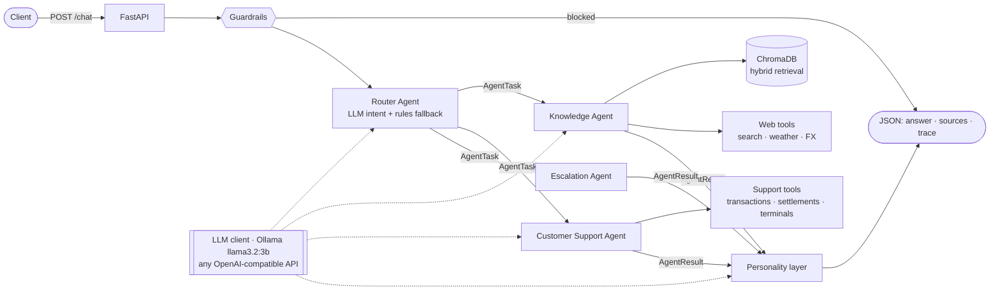

# Getnet AI Multi-Agent Support System

Multi-agent AI customer support system featuring intelligent routing, RAG-powered knowledge
retrieval and customer support tools. Built for the **Getnet AI Hardcore Engineer** technical
assessment.

> **It runs 100 % free and local.** The LLM is `llama3.2:3b` on Ollama, embeddings come from
> multilingual MiniLM (ONNX, CPU), the vector database is ChromaDB, and web data comes from free
> public APIs. The LLM layer is OpenAI-compatible, so Groq (free tier) or OpenAI can be used by
> changing `.env`.

---

## Contents
1. [Overview](#1-overview)
2. [Architecture](#2-architecture)
3. [Agents](#3-agents)
4. [Tech stack](#4-tech-stack)
5. [Spec-Driven Development](#5-spec-driven-development)
6. [Quick start (local)](#6-quick-start-local)
7. [Configuration](#7-configuration)
8. [Docker](#8-docker)
9. [Tests](#9-tests)
10. [API](#10-api)
11. [RAG pipeline](#11-rag-pipeline)
12. [Agent communication workflow](#12-agent-communication-workflow)
13. [LLM integration & prompt strategy](#13-llm-integration--prompt-strategy)
14. [Guardrails, handoff & observability (bonus)](#14-guardrails-handoff--observability-bonus)
15. [Design decisions & trade-offs](#15-design-decisions--trade-offs)
16. [Known limitations](#16-known-limitations)
17. [Production readiness & evaluation strategy](#17-production-readiness--evaluation-strategy)
18. [Future enhancements](#18-future-enhancements)

---

## 1. Overview

A merchant sends a message to `POST /chat`. The **Router Agent** classifies the intent and builds
a plan: one agent, or a sequence of agents. It then runs the specialists, passing each agent's
result to the next, and a **Personality** layer consolidates everything into one on-brand
answer. The response includes sources and a full execution trace.

| Capability | Implementation |
|---|---|
| Router (entry point, plans, data flow) | LLM JSON intent classification with a rules fallback; sequential plans with context propagation |
| Knowledge Agent | **Hybrid RAG** over 46 official Getnet pages (`getnet.net/en` + `site.getnet.com.br`) **plus** web tools (search, weather, FX) |
| Customer Support Agent | 3 tools over **simulated** merchant data: transactions, settlement schedule, terminal status |
| Escalation Agent (bonus, 4th agent) | Human handoff: opens a simulated ticket with the full context |
| Guardrails (bonus) | Prompt-injection and unsafe-content blocking; card/CPF/CNPJ masking before the LLM sees the text |
| Observability (bonus) | JSON logs with a `trace_id`; per-step agent, tool, latency and status in every response |

## 2. Architecture



This follows the assessment's reference diagram (*Input → Router → Knowledge / Customer Support
/ Custom agent + Tools → Personality → Output*). Details: [`docs/architecture.md`](docs/architecture.md).

```
app/
├── main.py                 # FastAPI: POST /chat, GET /health, error handler
├── container.py            # composition root (dependency injection)
├── config.py               # pydantic-settings (env-driven)
├── agents/
│   ├── router.py           # Router Agent + orchestration
│   ├── knowledge.py        # Knowledge Agent (RAG + web tools)
│   ├── customer_support.py # Customer Support Agent (tool planning + execution)
│   ├── escalation.py       # Escalation Agent (bonus)
│   ├── personality.py      # Personality / consolidation layer
│   ├── prompts.py          # all prompts, in one place
│   └── base.py             # BaseAgent (timing, error isolation, language detection)
├── rag/
│   ├── ingest.py           # crawl → extract → snapshot → chunk → index (CLI)
│   ├── chunker.py          # paragraph-aware chunking with overlap
│   ├── hybrid.py           # BM25 + Reciprocal Rank Fusion
│   └── store.py            # fastembed embeddings, ChromaDB store, hybrid Retriever
├── tools/
│   ├── customer.py         # 3 support tools over simulated data
│   └── web.py              # web_search, get_weather, get_exchange_rate
├── models/schemas.py       # API contract + AgentTask/AgentResult messages
└── services/               # llm client, guardrails, observability
data/corpus/pages.jsonl     # snapshot of extracted official Getnet pages (46 pages)
scripts/live_check.py       # live validation of the 10 PDF scenarios (real LLM)
tests/                      # 74 offline tests
docs/                       # SDD: spec, architecture, decisions, plan, traceability, demo
```

## 3. Agents

| Agent | Responsibility | Tools / data |
|---|---|---|
| **Router** (`agents/router.py`) | Entry point. Runs guardrails, classifies intent (`product_info`, `general`, `customer_account`, `troubleshooting`, `human`), maps the intent to a plan, runs agents in sequence passing context, triggers handoff on failure, and calls Personality. | LLM (JSON mode) + regex rules |
| **Knowledge** (`agents/knowledge.py`) | Product questions are answered by RAG over Getnet's official sites, with numbered citations. General questions are answered by web tools. | `rag_retrieve`, `web_search`, `get_weather`, `get_exchange_rate` |
| **Customer Support** (`agents/customer_support.py`) | The LLM plans which tools to call (validated against the registry, with a rules safety net). The agent runs them for the `user_id` and writes a contextual answer that discloses the data is simulated. | `get_customer_profile`, `get_transaction_status`, `get_settlement_schedule`, `get_terminal_status` |
| **Escalation** (`agents/escalation.py`, bonus) | Human handoff: a ticket with a protocol number and a summary of what each agent found. | simulated queue |
| **Personality** (`agents/personality.py`) | Merges multi-agent answers into one reply in Getnet's voice (one LLM call, only when 2 or more agents answered). | LLM |

Which agents handle each intent:

| Intent | Plan | PDF examples |
|---|---|---|
| `product_info` | Knowledge (RAG) | Clássica vs Smart, Pix account, antecipação, crediário, WhatsApp Payment Link |
| `general` | Knowledge (web tools) | Porto Alegre weather, euro rate |
| `customer_account` | Customer Support | yesterday's sales deposit |
| `troubleshooting` | Customer Support → Knowledge | machine won't connect, decline error |
| `human` | Escalation | "I want to talk to a human" |

## 4. Tech stack

| Layer | Choice | Why |
|---|---|---|
| Language/API | Python 3.11+, FastAPI, Pydantic v2 | Typed contracts, automatic OpenAPI docs, async |
| LLM | **Ollama + `llama3.2:3b`** (default) | Free; runs on a MacBook M1 with 8 GB; supports JSON mode |
| LLM client | Single OpenAI-compatible client (httpx) | Switch to Groq or OpenAI by changing `.env` |
| Embeddings | fastembed `paraphrase-multilingual-MiniLM-L12-v2` | Free, CPU/ONNX, **multilingual** (English questions, Portuguese pages) |
| Vector DB | ChromaDB (embedded, persistent, cosine) | A real vector store with metadata and no extra service |
| Retrieval | **Hybrid**: dense + BM25 with Reciprocal Rank Fusion | Dense search alone ranked product names ("Get Clássica") poorly |
| Web | Tavily (optional key) → DuckDuckGo Instant Answer → Wikipedia; Open-Meteo → wttr.in; Frankfurter (ECB) | Free, official APIs, citable sources |
| Tests | pytest, pytest-asyncio, httpx `MockTransport` | Fully offline and deterministic |
| Packaging | Docker, docker compose | The embedding model and the index are baked into the image |

No LangChain or LlamaIndex. The orchestration is small, and hand-written code is easier to
read, test and explain (see ADR-002 in [`docs/decisions.md`](docs/decisions.md)).

## 5. Spec-Driven Development

The specs were written **before** the code and drove the implementation:

| Doc | Content |
|---|---|
| [`docs/spec.md`](docs/spec.md) | Functional and non-functional requirements (FR-/NFR-/BR- IDs) with acceptance criteria, API contract, routing contract, error handling |
| [`docs/architecture.md`](docs/architecture.md) | Components, communication mechanism, sequence diagram, RAG pipeline |
| [`docs/decisions.md`](docs/decisions.md) | 11 ADRs (framework choice, local LLM, embeddings, vector DB, web APIs, ...) |
| [`docs/implementation-plan.md`](docs/implementation-plan.md) | Time-boxed plan with priorities (P0/P1/P2) and testing strategy |
| [`docs/traceability.md`](docs/traceability.md) | Every PDF requirement mapped to code, verification and status |

The 10 example scenarios from the PDF were turned into **executable acceptance tests**
(`tests/test_scenarios.py`) before the routing rules were finalized.

## 6. Quick start (local)

Prerequisites: Python 3.11+ and [Ollama](https://ollama.com/download).

```bash
ollama pull llama3.2:3b
```

```bash
python3 -m venv .venv && source .venv/bin/activate
```

```bash
pip install -r requirements-dev.txt
```

```bash
cp .env.example .env
```

```bash
python -m app.rag.ingest
```

`python -m app.rag.ingest` builds the vector index from the committed snapshot. It takes about
10 seconds the first time, plus a ~220 MB download of the embedding model.

```bash
uvicorn app.main:app --port 8000
```

```bash
curl -s localhost:8000/chat -H 'content-type: application/json' \
  -d '{"message": "When will the money from yesterday'"'"'s sales be deposited?", "user_id": "cliente1988"}' | python3 -m json.tool
```

Interactive API docs: http://localhost:8000/docs

To refresh the knowledge base from the live Getnet websites:

```bash
python -m app.rag.ingest --crawl
```

## 7. Configuration

All settings come from environment variables (see [`.env.example`](.env.example)). No secrets are
needed for the default setup.

| Variable | Default | Notes |
|---|---|---|
| `LLM_BASE_URL` | `http://localhost:11434/v1` | Any OpenAI-compatible endpoint |
| `LLM_MODEL` | `llama3.2:3b` | e.g. `llama-3.1-8b-instant` on Groq |
| `LLM_API_KEY` | `ollama` | Needed only for cloud providers |
| `LLM_PROVIDER` | `ollama` | Label shown in responses and logs |
| `RAG_TOP_K` / `RAG_MIN_SCORE` | `5` / `0.25` | Retrieval depth / minimum cosine similarity |
| `CHUNK_SIZE` / `CHUNK_OVERLAP` | `900` / `150` | Characters |
| `TAVILY_API_KEY` | empty | Optional (free tier) for better general web search |
| `AUTO_INGEST` | `true` | Builds the index at startup if it is empty |

To use the **Groq free tier** instead of a local model (no billing), set:
`LLM_BASE_URL=https://api.groq.com/openai/v1`, `LLM_MODEL=llama-3.1-8b-instant`, `LLM_API_KEY=<key>`.

## 8. Docker

The image bakes in the embedding model and the vector index, so it starts in seconds without
downloads. The LLM runs **natively on the host**. On Apple Silicon this lets Ollama use the Metal
GPU; Docker on macOS can't reach the GPU.

```bash
ollama pull llama3.2:3b
```

```bash
docker compose up --build
```

```bash
curl -s localhost:8000/health
```

Plain Docker commands, without compose:

```bash
docker build -t getnet-ai-multiagent-system .
```

```bash
docker run --rm -p 8000:8000 --add-host=host.docker.internal:host-gateway -e LLM_BASE_URL=http://host.docker.internal:11434/v1 getnet-ai-multiagent-system
```

Run the test suite inside the image:

```bash
docker run --rm getnet-ai-multiagent-system python -m pytest -q
```

Behind a TLS-intercepting corporate proxy, pass its CA as an optional build secret:
`docker build --secret id=ca_bundle,src=/path/to/corp-ca.crt -t getnet-ai-multiagent-system .`

On Linux without a native Ollama, use the bundled Ollama service:
`docker compose --profile ollama up --build`, then
`docker compose exec ollama ollama pull llama3.2:3b`, and set `LLM_BASE_URL=http://ollama:11434/v1`.

## 9. Tests

```bash
python -m pytest -q
```

```bash
python -m pytest --cov=app --cov-report=term-missing
```

Current result: **74 passed, 88 % line coverage of `app/`**, all offline.

### Testing strategy

| Layer | What is verified | How |
|---|---|---|
| **Unit** | chunker, BM25/RRF, HTML extraction, guardrails, the 3 support tools, web-tool parsers, rules router | Pure functions, deterministic data |
| **Component** | Each agent in isolation: RAG answers with real sources, web tools, tool planning, hallucinated-tool rejection, template fallback when the LLM is down | `FakeLLM` (scripted, records prompts), `HashEmbedder`, httpx `MockTransport` |
| **Integration (orchestration)** | Router → agents → Personality: plans, **context propagation between agents** (asserted on the actual prompt), handoff on agent failure, guardrails before routing, PII never reaching the LLM, LLM outage → rules + extractive answers | Full container with fakes, over the **real** committed corpus |
| **API contract** | Response schema, 422 on invalid payloads (8 cases + malformed JSON), 500 JSON on unhandled errors, `/health` | FastAPI `TestClient` |
| **Scenario regression** | The **10 PDF scenarios**: intent, agents invoked, tools used, source types, status | `tests/test_scenarios.py` |
| **Live validation** (separate, opt-in) | The same 10 scenarios against the **real** LLM, real index and real APIs | `python -m scripts.live_check` → [`docs/live-validation.md`](docs/live-validation.md) |

> **Mocked vs real.** The automated suite (CI) never calls a real LLM or the internet, which
> makes it deterministic, fast (~30 s) and free. Real behaviour (real `llama3.2:3b`, real
> retrieval, live weather/FX APIs) is validated by `scripts/live_check.py`. Its latest output
> is committed in [`docs/live-validation.md`](docs/live-validation.md).

**How I would extend integration testing for production:**
1. A contract test per external API, recorded with VCR-style cassettes and refreshed nightly.
2. A golden dataset of about 200 labelled questions (intent, expected agents, expected source
   URLs) running in CI for routing accuracy, so any drop blocks the merge.
3. RAG evaluation (hit-rate / MRR@5 on the expected URLs) plus LLM-as-judge faithfulness and
   answer relevance (e.g. Ragas), run nightly against the real model.
4. A chaos suite: LLM timeouts, 429s and malformed JSON, asserting graceful degradation.
5. Load tests (Locust) to measure p95 latency and decide on concurrency and model sizing.

## 10. API

### `POST /chat`

Request:

```json
{ "message": "My card machine won't connect to the internet, what should I do?", "user_id": "cliente1988" }
```

Response (abridged; real structure):

```json
{
  "answer": "Your Get Clássica terminal T-002 has been offline for about 5 hours (chip registration failed)... Steps: ... [1] ... (simulated demo data)",
  "status": "success",
  "agent": "customer_support",
  "agents_invoked": ["customer_support", "knowledge"],
  "sources": [
    {"title": "Simulated merchant data: get_terminal_status", "url": "tool://get_terminal_status", "type": "tool", "score": null},
    {"title": "Dúvidas e Perguntas Frequentes | Getnet", "url": "https://site.getnet.com.br/duvidas/", "type": "rag", "score": 0.49}
  ],
  "metadata": {
    "trace_id": "4f7c…",
    "route": {"intent": "troubleshooting", "agents": ["customer_support", "knowledge"], "reason": "…", "method": "llm"},
    "steps": [
      {"agent": "customer_support", "status": "success", "latency_ms": 9012, "tools": ["get_customer_profile", "get_terminal_status"], "error": null},
      {"agent": "knowledge", "status": "success", "latency_ms": 7310, "tools": ["rag_retrieve"], "error": null}
    ],
    "personality_llm_merge": true,
    "latency_ms": 21544,
    "llm_provider": "ollama", "llm_model": "llama3.2:3b",
    "guardrails": {"pii_masked": false, "flags": []}
  }
}
```

`status` is one of `success`, `partial` (degraded: the LLM or a tool was unavailable), `escalated`
(human handoff), `blocked` (guardrail) or `error`.

Errors: `422` for invalid input (empty or blank message, more than 2000 characters, `user_id`
outside `[A-Za-z0-9_.-]{1,64}`, malformed JSON). `500` returns `{"status":"error","detail":"Internal server error"}`.

### `GET /health`

```json
{"status": "ok", "llm": {"provider": "ollama", "model": "llama3.2:3b", "reachable": true},
 "vector_store": {"collection": "getnet_kb", "chunks": 195}}
```

More example answers produced by the real model are in [`docs/live-validation.md`](docs/live-validation.md).

## 11. RAG pipeline

**Ingestion → storage → retrieval → generation**

1. **Ingestion** (`app/rag/ingest.py`): an `httpx` crawler starts from the official seed URLs
   (`https://www.getnet.net/en/` from the PDF; `https://site.getnet.com.br/`, the site the PDF
   links as the company website; and its official FAQ pages, *Dúvidas*). It follows internal
   product and help links at depth 1, filtered by allow-list, and identifies itself with a clear User-Agent.
2. **Extraction:** BeautifulSoup removes scripts, styles, navigation and footer, keeps headings,
   paragraphs, list items and table cells, and removes repeated blocks.
3. **Snapshot:** `data/corpus/pages.jsonl` (46 pages, about 127k characters, URL and title per
   page). It is committed so that builds are reproducible and ingestion can be audited. `--crawl` refreshes it.
4. **Chunking:** paragraph-aware chunks of about 900 characters with 150 characters of overlap.
   The page title is prepended to each chunk. This produces 195 chunks.
5. **Embedding:** multilingual MiniLM (384 dimensions) via fastembed/ONNX. An English question
   and its Portuguese equivalent score **0.945** cosine similarity.
6. **Storage:** a ChromaDB persistent collection (cosine). Upserts are idempotent, keyed by a content hash.
7. **Retrieval (hybrid):** the dense top-30 and the BM25 top-30 (accent-folded tokens) are fused
   with **Reciprocal Rank Fusion**. Hits below the cosine threshold are dropped, and the top 5 are returned.
8. **Generation:** numbered context blocks plus a strict prompt (answer **only** from the context,
   cite `[n]`, say when the information isn't found, answer in the user's language). `sources[]`
   is built **from the retrieved chunks, never by the LLM**, so citations can't be invented.

Why hybrid? During development, dense-only retrieval for *"Get Clássica vs Get Smart"* returned
the careers FAQ page, and the model correctly answered "not found". BM25 catches exact product
names, so the pricing page now ranks first. A regression test covers this (`tests/test_rag.py`).

## 12. Agent communication workflow

Agents exchange **typed Pydantic messages through direct async calls**:

```
AgentTask(trace_id, user_id, message, intent, context: list[AgentResult])  ──►  agent.run()
AgentResult(agent, status, answer, sources, data, tools_used, confidence, latency_ms, error)
```

Example: **"My card machine won't connect to the internet"**
1. The Router classifies it as `troubleshooting`, giving the plan `[customer_support, knowledge]`.
2. Customer Support plans `get_terminal_status` and finds that **T-002 (Get Clássica) has been
   offline for 5 hours, with chip registration failed**.
3. The Knowledge Agent receives that result in `task.context`. It retrieves official help content
   and writes steps tailored to the diagnosis.
4. Personality merges both into one reply: the diagnosis first, then the steps, with citations.

`BaseAgent.run` isolates failures: an exception becomes `AgentResult(status="error")`, and the
Router then hands off to the Escalation agent. One failing agent never causes an HTTP 500.

## 13. LLM integration & prompt strategy

- **One OpenAI-compatible client** (`app/services/llm.py`) covers Ollama `/v1`, Groq and OpenAI.
  Agents depend on a `LLMClient` protocol, so tests inject a `FakeLLM`.
- **The LLM decides, code validates.** The router and the tool planner use `response_format: json_object`.
  The output is parsed, validated with Pydantic, and the tool names are checked against the
  registry (a hallucinated tool is dropped). Invalid output falls back to deterministic rules,
  and `metadata.route.method` records `llm` or `rules`.
- **The LLM picks the intent; code maps intent to plan.** This is the easy job for a 3B model,
  and the plans stay auditable.
- **Prompts** (`app/agents/prompts.py`) use a role, hard constraints, a few-shot examples (router)
  and an output format. Shared rules: answer in the user's language (detected and stated
  explicitly, because small models drift towards the language of the context), never invent
  data, cite `[n]`, disclose simulated data.
- **Low temperature** (0.1), capped `max_tokens`, and short focused contexts (top-5 chunks).
- **Things that don't depend on the model:** the "(simulated demo data)" note and `sources[]` are
  added by code, not left to the model.
- **LLM calls per request:** 2 for single-agent plans (route + answer, plus the planner for
  support) and 4–5 for troubleshooting. Personality skips its call when only one agent answered.

## 14. Guardrails, handoff & observability (bonus)

- **Guardrails** (`app/services/guardrails.py`): regex detection of prompt injection (English and
  Portuguese) and unsafe or fraud requests (card cloning, money laundering, bypassing anti-fraud)
  returns `status: "blocked"` before any LLM call. Card numbers are Luhn-validated and masked, and
  CPF/CNPJ are masked. The masked text is what the agents and the LLM see.
- **Human handoff:** an explicit request (`human` intent), all agents failing, or zero retrieval
  confidence on a product question routes to the **Escalation Agent**. It creates a ticket
  (`GN-XXXXXXXX`) with the transcript and agent summaries, and the response has `status: "escalated"`.
- **Observability:** JSON logs (`routed`, `agent_completed`, `request_completed`, `request_blocked`)
  with `trace_id`, agent, tools, latency and confidence. The same trace is returned in `metadata`
  for debugging from the client side.

## 15. Design decisions & trade-offs

| Decision | Trade-off |
|---|---|
| Local 3B model instead of GPT-4-class | Free and private, but weaker reasoning and slower on CPU. Mitigated with JSON + validation, rules fallback, tight prompts and code-enforced guarantees |
| Hand-written orchestrator instead of LangGraph | Simple, transparent and testable, but no built-in graph persistence or parallel branches (the typed messages allow a later migration) |
| Sequential plans | Simple data flow and cheap on a local LLM, but higher latency than parallel fan-out for independent agents |
| Committed corpus snapshot | Reproducible and offline, but can go stale (`--crawl` refreshes it; production would schedule it) |
| Rules-based guardrails | Deterministic and add no latency, but lower recall than an ML classifier (e.g. Llama Guard) |
| Simulated customer data relative to "today" | "Yesterday's sales" always works in demos, but it isn't real data (clearly disclosed) |

All 11 ADRs: [`docs/decisions.md`](docs/decisions.md).

## 16. Known limitations

- **Customer data is simulated** (`cliente1988`, `cliente2024`). No real Getnet systems are accessed.
- **Small model quality:** `llama3.2:3b` sometimes paraphrases loosely or ignores formatting
  instructions. Factual grounding is enforced by retrieval and code-built sources, but answer
  quality improves noticeably with an 8B+ model or a cloud model.
- **Latency:** see [`docs/live-validation.md`](docs/live-validation.md). The committed report ran
  on a **4-vCPU cloud container without a GPU** (tens of seconds per request). On an Apple M1,
  Ollama uses the Metal GPU and is several times faster.
- **Free web APIs** rate-limit shared IPs. There is a fallback chain plus retries, but
  availability isn't guaranteed. The DuckDuckGo Instant Answer API covers encyclopedic queries,
  not arbitrary news; a Tavily free key improves general search.
- **Static crawl:** content rendered by client-side JavaScript isn't captured.
- No authentication, rate limiting or persistent conversation memory (single-turn).

## 17. Production readiness & evaluation strategy

| Area | Plan |
|---|---|
| **Quality evaluation** | Golden dataset (intent → agents → expected URLs) in CI; RAG hit-rate@5/MRR; LLM-as-judge for faithfulness, relevance and tone (Ragas/DeepEval) nightly; human review of a sample of escalations |
| **Online metrics** | Routing method ratio (`llm` vs `rules` fallback), escalation rate, `partial`/`error` rate, retrieval top score distribution, thumbs up/down feedback |
| **Tracing** | Export the existing per-step spans to OpenTelemetry (Azure Monitor / Langfuse) with trace_id, tokens, latency per agent and per tool |
| **Dashboards & alerts** | p95 latency, error rate, fallback spikes (LLM degradation), escalation spikes, tool 429s, index freshness |
| **Reliability** | Circuit breakers per tool, response caching for FX/weather, async job for crawling, managed vector DB, horizontal scaling behind a gateway |
| **Security** | AuthN/Z (merchant identity from token, not request body), rate limiting, secret manager, LLM-based moderation, PII redaction in logs, LGPD retention policies |

## 18. Future enhancements

- Multi-turn memory (session store) and clarifying questions.
- Parallel fan-out for independent agents, or LangGraph if workflows grow.
- Cross-encoder reranker; scheduled re-crawl with change detection; sitemap-based ingestion.
- Native tool/function calling with larger models; streaming responses (SSE).
- Real integrations (transactions/settlement APIs) behind the same tool interfaces.
- Teams/Slack handoff for the Escalation agent; CSAT feedback loop into the eval dataset.

---

*Author: Mariana Nascimento — Getnet AI Hardcore Engineer technical assessment.*
