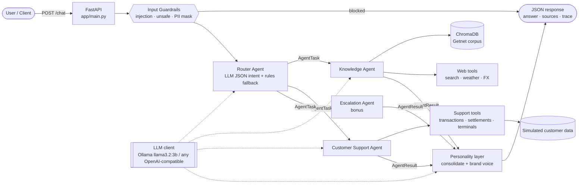
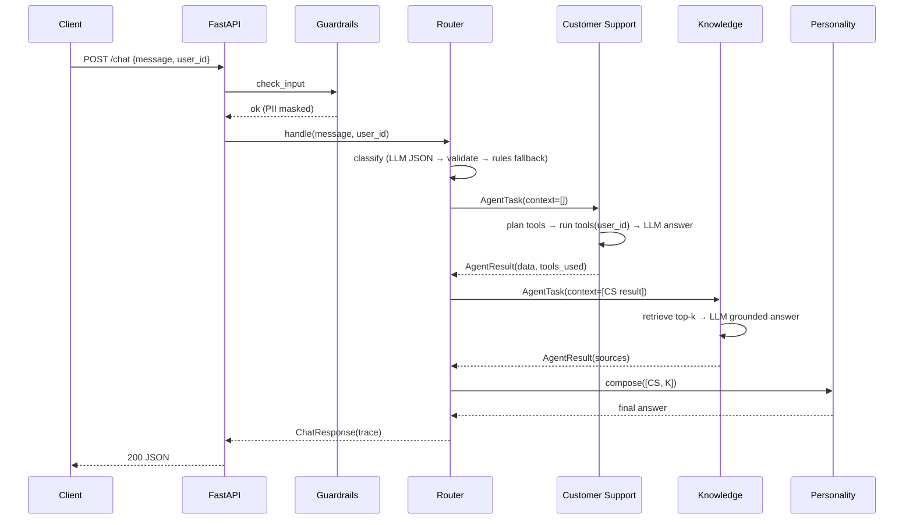
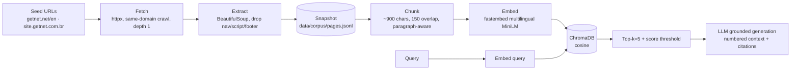
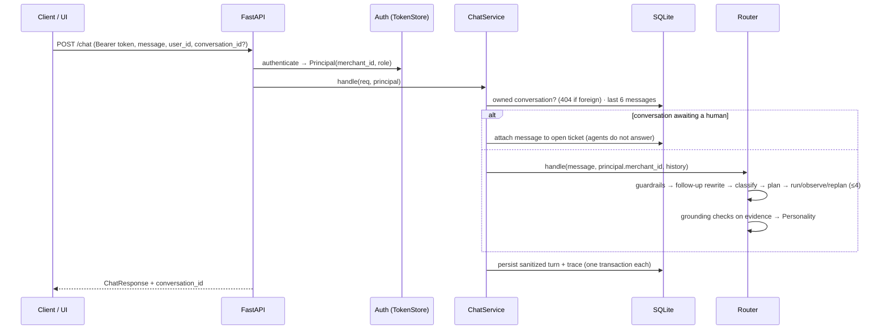

# Architecture

## 1. Component view



This mirrors the PDF's reference diagram: **Input → Router → {Knowledge, Customer Support, Custom
agent} + tools → Personality → Output**.

## 2. Agents

| Agent | File | Responsibility | Tools / data |
|-------|------|----------------|--------------|
| Router | `app/agents/router.py` | Entry point. Classifies intent (LLM JSON mode, validated by Pydantic, with a keyword-rules fallback), builds an ordered plan, runs agents sequentially while passing earlier results as context, escalates on failure or low confidence, and hands off to Personality. | LLM |
| Knowledge | `app/agents/knowledge.py` | Getnet product questions answered with **RAG**. General questions answered with **web tools**. Generates grounded answers with citations. | `Retriever` (Chroma), `web_search`, `get_weather`, `get_exchange_rate` |
| Customer Support | `app/agents/customer_support.py` | Account-specific questions. Selects tools (LLM JSON plan validated against the tool registry, with a rules fallback), executes them for `user_id`, and writes a contextual answer. | `get_customer_profile`, `get_transaction_status`, `get_settlement_schedule`, `get_terminal_status` |
| Escalation (bonus) | `app/agents/escalation.py` | Human handoff. Opens a simulated ticket with the conversation summary and returns the protocol number. | in-memory ticket queue |
| Personality | `app/agents/personality.py` | Final layer. Merges multiple agent results into one answer in Getnet's voice (friendly, concise, same language as the user). | LLM (multi-agent only) |

## 3. Communication mechanism

Agents communicate through **direct async function calls with typed messages** (Pydantic):

```
AgentTask(trace_id, user_id, message, intent, context: list[AgentResult])
        ──► Agent.run(task) ──►
AgentResult(agent, status, answer, sources, data, tools_used, confidence, latency_ms, error)
```

The Router owns the workflow. For the plan `[customer_support, knowledge]`, the Customer Support
result (for example, "terminal T-002 offline since 08:14, last decline code 51") is appended to
`task.context` before the Knowledge Agent runs. Knowledge therefore searches the knowledge base
with the user's situation in mind, and the Personality layer receives both results.

Direct calls were chosen over a message queue because the latency budget is a single HTTP
request, there is one process, and the calls are easy to test. The typed `AgentTask`/`AgentResult`
envelope means the transport could be swapped for a queue (e.g. Redis Streams, Service Bus)
without changing the agents.

## 4. Message workflow (sequence)



## 5. RAG pipeline



1. **Ingestion:** `python -m app.rag.ingest --crawl` fetches the seed URLs and follows internal
   product links (bounded by `max_pages`).
2. **Extraction:** the main text is kept and boilerplate removed. The page title and URL are kept as metadata.
3. **Snapshot:** extracted pages are saved to `data/corpus/pages.jsonl`. This keeps builds
   reproducible and offline-capable, and lets ingestion be audited. Running with `--crawl` refreshes it.
4. **Chunking:** paragraph-aware chunks with overlap.
5. **Embeddings:** `sentence-transformers/paraphrase-multilingual-MiniLM-L12-v2` via fastembed
   (ONNX, CPU, multilingual, so English questions retrieve Portuguese pages).
6. **Storage:** ChromaDB persistent collection, cosine distance, with an idempotent upsert keyed by a chunk hash.
7. **Retrieval:** top-k by similarity. Results below `RAG_MIN_SCORE` are dropped.
8. **Generation:** the LLM is instructed to answer **only** from the numbered context, cite `[n]`,
   and say when the answer is not in the context. `sources[]` is built from the retrieved
   chunks, never by the LLM.

## 6. LLM usage and prompt strategy

- **One OpenAI-compatible client** (`app/services/llm.py`): Ollama exposes `/v1/chat/completions`.
  Groq and OpenAI work by changing `LLM_BASE_URL`/`LLM_MODEL`/`LLM_API_KEY`.
- **Structured output** for control decisions: the router and the tool planner request
  `response_format={"type":"json_object"}`. The output is validated with Pydantic. On failure, a
  deterministic rules engine takes over (`method: "rules"` is recorded in the trace).
- **Low temperature** (0.1) for routing and grounded answers.
- **Prompts** live in `app/agents/prompts.py`. Each one states the role, hard constraints (no
  invented data, cite sources, same language as the user, mention simulated data), and the output format.

## 7. Cross-cutting

- **Guardrails** (`app/services/guardrails.py`): prompt-injection and unsafe-content patterns,
  masking of card numbers/CPF/CNPJ, and a message-length cap.
- **Observability** (`app/services/observability.py`): JSON logs carrying a `trace_id`, per-step
  latency, and the route method. The trace is also returned in `metadata`.
- **Configuration** (`app/config.py`): `pydantic-settings`, env-driven, documented in `.env.example`.

---

## 8. v2 additions



- **State** (`app/state/`): one SQLite file — `credentials` (hashes only), `conversations`,
  `messages`, `tickets`, `request_traces`.
- **HITL** (`app/state/tickets.py`): `open → claimed → resolved | rejected`; resolution writes the
  operator message and reactivates the conversation atomically.
- **Grounding** (`app/rag/grounding.py`): runs inside the Knowledge agent on the exact evidence it
  generated from; the runtime acts only on deterministic failures.
- **UI** (`app/static/`): static files served at `/ui` with a strict CSP; uses the same API.
